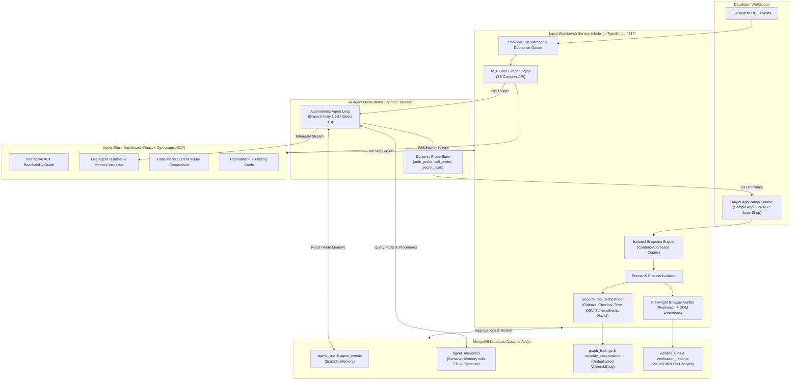

# CyberSec Harness

> **Autonomous Local-First Security Engineering Workbench & AI Agent Harness**  
> *Real-time AST code reachability, visual website regression verification, multi-tool security orchestration, and intelligent episodic memory powered by MongoDB & local SLMs.*

[](https://opensource.org/licenses/MIT)
[](https://nodejs.org/)
[](https://python.org/)
[](https://www.mongodb.com/)
[](https://ollama.ai/)

---

## Brief of the Developer Tool (CyberSec Harness)

**CyberSec Harness** is a privacy-first, developer-centric security workbench designed to bridge the gap between static code analysis, active dynamic scanning, and autonomous AI-assisted remediation. Modern application security tools are either slow batch CI scanners that flood developers with noisy alerts or cloud LLM wrappers that leak proprietary source code and lack state awareness.

CyberSec Harness runs **100% locally on your machine**:
1. **Watches Your Codebase in Real-Time:** Using TypeScript Compiler AST APIs, it builds a live, queryable dependency graph mapping `Endpoints → Handlers → Services → Database Ops → Sensitive Sinks`.
2. **Visual & Functional Web Verification:** Automatically spins up ephemeral isolated snapshots of your application (baseline vs. current working tree) and runs Playwright-driven browser scenarios with pixel-level and DOM regression diffing.
3. **Autonomous AI Security Agent:** Powered by local Small Language Models (e.g., `IHA089/drana-infinity-1.5b` or `qwen3:4b`), the agent inspects modified code paths, dynamically selects the most relevant security scanners, and executes targeted endpoint probes (`auth_probe`, `sqli_probe`, `secret_scan`).
4. **Deep MongoDB-Powered Episodic & Semantic Memory:** Unlike stateless scanners, CyberSec Harness stores complete agent execution traces, evidence chains, and historical vulnerability states in MongoDB, allowing the agent to remember past findings, prevent redundant probes, and track finding lifecycles across code iterations.

---

## System Architecture

The following diagram illustrates the complete end-to-end dataflow of CyberSec Harness:



### Component Breakdown
- **AST Code Reachability Engine (`packages/service`):** Employs the TypeScript compiler API to extract semantic symbols, endpoint registrations, middleware chains, and tainted dataflows toward sensitive sinks (e.g., `db.query`, file writes, shell exec).
- **Security Scanner Suite:** Aggregates static and dynamic tools into unified canonical findings:
  - *Dependencies:* OSV.dev API, OSV-Scanner, npm audit, Trivy.
  - *Secrets:* Gitleaks 8.19+ (with regex redaction and entropy scoring).
  - *Infrastructure as Code (IaC):* Checkov 3.x (Dockerfiles, Kubernetes, Terraform).
  - *API Fuzzing & Web Scans:* Schemathesis 4.x and Nuclei 3.x.
- **AI Agent Orchestrator (`packages/orchestrator`):** Lightweight Python daemon consuming harness WebSocket feeds. Uses local SLMs via Ollama to reason over code changes and dispatch surgical probes against running instances.
- **Dashboard (`packages/dashboard`):** Modern React SPA featuring fluid glassmorphism, responsive Cytoscape.js directed acyclic graphs, live agent execution telemetry, and an auto-scrolling MongoDB memory inspector.

---

## Technical Approach

### 1. Incremental AST Diffing & Call Graph Reachability
Instead of re-analyzing the entire workspace on every keystroke, CyberSec Harness implements an incremental TypeScript compiler language service. When a file is modified:
- File ASTs are parsed and diffed against the previous snapshot.
- Impact propagation traversals determine which HTTP routes or client components depend on the modified function.
- High-risk paths reaching unparameterized database queries or unauthenticated endpoints are immediately highlighted in orange on the live dashboard.

### 2. Autonomous Local SLM Tool Planning
Rather than invoking high-latency, cloud-based LLMs that introduce security and privacy risks:
- We fine-tune / prompt specialized small models (such as `IHA089/drana-infinity-1.5b` or `qwen3:4b-instruct`) running entirely on local CPU/GPU via Ollama.
- Inference latency is ultra-low (~110ms warm response), enabling sub-second reaction times to file saves.
- The agent uses structured JSON schema tool calls to select only ready and relevant security probes (e.g. skipping SQLi testing if an endpoint has no database dependencies).

### 3. Dual-Branch Visual & Functional Verification
To prevent false-positive alerts:
- The harness creates an isolated, disposable content-addressed snapshot of the application.
- Both the **baseline** (clean branch/commit) and the **current candidate** (working tree) are executed in parallel process groups.
- Playwright executes real browser interactions, and `pixelmatch` computes visual regressions with dynamic timestamp masking.
- Observations link directly back to the specific network requests captured during the browser session.

---

## Usage of MongoDB in Depth and How Uniquely It's Used

MongoDB serves as the backbone of CyberSec Harness, moving far beyond a traditional database to act as an **active cognitive memory and verification engine**.

```
┌─────────────────────────────────────────────────────────────────────────────┐
│                       CYBERSEC HARNESS MONGODB SCHEMA                       │
├───────────────────────────────┬─────────────────────────────────────────────┤
│ Core Security Collections     │ AI Agent Memory & Cognition Collections     │
├───────────────────────────────┼─────────────────────────────────────────────┤
│ • graph_findings              │ • agent_runs (Execution Sessions)           │
│ • security_observations       │ • agent_events (Episodic Memory Stream)     │
│ • file_events                 │ • agent_memories (Semantic Long-Term Store) │
│ • graph_snapshots             │ • agent_requirements (Policy & Compliance)  │
│ • website_runs                │                                             │
│ • verification_records        │                                             │
└───────────────────────────────┴─────────────────────────────────────────────┘
```

### Unique Architectural Highlights of MongoDB in CyberSec Harness:

#### 1. Dual-Tiered Validation: Application Types + Native `$jsonSchema`
To guarantee absolute data integrity from autonomous agent writes without crashing the service, CyberSec Harness enforces validation in two stages:
1. **Pre-flight TypeScript Validators:** Clean and sanitize payloads, redact secrets, and validate bounds before sending queries.
2. **Database-Enforced `$jsonSchema`:** Every collection is initialized with strict MongoDB schema validation rules. Even if an experimental LLM generates unexpected fields or payload structures, MongoDB rejects invalid mutations at the database level.

#### 2. Episodic vs. Semantic Memory Architecture for AI Agents
The orchestrator implements cognitive science memory separation:
- **Episodic Memory (`agent_events`):** A chronological, immutable sequence of every thought, plan, tool call, duration, and raw output generated during a run.
- **Semantic Long-Term Memory (`agent_memories`):** Distilled facts, procedures, and feedback about specific endpoints or packages.
  - *Subject Indexing:* Compound indexes over `(projectId, subject.type, subject.key)` allow instant lookup (e.g., `subject.type: "endpoint"`, `key: "GET /api/orders/:id"`).
  - *Evidence Chains:* Every memory must link to supporting observation IDs (`evidence: [{ kind: "finding", id: "..." }]`). An agent-written memory without evidence is automatically stored as `unverified` with `low` confidence.

#### 3. Dynamic Memory-Aware Probe Pruning
To prevent redundant load on target servers:
- Before running an active security probe (e.g., `sqli_probe`), the agent queries `agent_memories`.
- If an endpoint was already verified clean under the current AST graph hash, the agent prunes the probe from its plan and logs:  
  `sqli_probe skipped (memory: already clean)`.
- If code changes alter the AST of the handler, the graph hash changes, invalidating the memory and prompting a re-test.

#### 4. Automatic Expiry with Native TTL Indexes
Security findings and dynamic observations have natural lifespans. The `agent_memories` collection leverages MongoDB **TTL (Time-To-Live) indexes** on `expiresAt`:
```javascript
db.agent_memories.createIndex(
  { expiresAt: 1 },
  { expireAfterSeconds: 0, partialFilterExpression: { expiresAt: { $exists: true } } }
);
```
Temporary runtime facts automatically expire without needing background cron sweeps.

#### 5. Hybrid Keyword + Semantic Memory Search
When the agent needs to recall relevant past findings or procedures, it performs a **hybrid two-phase search** against `agent_memories`:
- **Keyword Phase:** MongoDB text index (`$text`) matches exact tool names, endpoint paths, CVE/GHSA identifiers, and CWE tags — ensuring zero missed exact-match recalls.
- **Semantic Phase:** Vectorized embeddings of memory content (via `nomic-embed-text` through Ollama) are stored as dense arrays and queried using MongoDB Atlas Vector Search (or a cosine-similarity aggregation pipeline locally). This catches semantically related findings even when the wording differs, e.g., "header missing auth" matching a prior memory about "no Authorization header check".
- The **reciprocal-rank fusion (RRF)** of both result sets is used to rerank candidates, giving accurate, context-aware recall across thousands of stored observations without needing a separate vector database.

#### 6. Cross-Collection Aggregation Pipelines
Complex security metrics are computed directly in the database via MongoDB Aggregation Pipelines:
- **Finding Deduplication & Grouping:** Grouping multi-scanner outputs (`security_observations`) into canonical `graph_findings` based on common advisory identifiers, CWE classifications, and affected source files.
- **Regression Detection:** Comparing finding sets between baseline snapshots and candidate runs to flag newly introduced vulnerabilities.

---

## Setup Instructions

### Prerequisites
- **Node.js:** v20.x or higher (v22+ recommended)
- **Python:** v3.10+ with `pip` and virtual environment support
- **MongoDB:** v6.0+ (Local Community Edition or MongoDB Atlas cluster)
- **Ollama:** For local SLM inference ([ollama.ai](https://ollama.ai))

### 1. Clone & Install Dependencies
```bash
git clone https://github.com/your-username/cybersec-harness.git
cd cybersec-harness

# Install project workspaces and Playwright browser
npm install
npx playwright install chromium

# Install sample target app
(cd sample-app && npm install)

# Build all packages (service, dashboard, extension)
npm run build
```

### 2. Configure Environment & MongoDB
Create a `.env` file in the root directory:
```bash
cp .env.example .env
```
Edit `.env` with your MongoDB connection details:
```env
WORKBENCH_PORT=4317
WORKBENCH_MONGO_URI=mongodb://127.0.0.1:27017
WORKBENCH_MONGO_DB=cybersec_harness
WORKBENCH_DATA_DIR=~/.local/share/workbench
```
*(If using **MongoDB Atlas**, simply paste your standard `mongodb+srv://...` URI).*

### 3. Download the Local SLM (Ollama)
We recommend **Drana-Infinity 1.5B** for fast, precise security tool selection (~110ms inference):
```bash
ollama pull IHA089/drana-infinity-1.5b:1.5b
```
*(Alternatively, `qwen3:4b-instruct-2507-q8_0` or `luisppb16/gemma4-e4b-SecOps` can also be used).*

### 4. Setup the AI Orchestrator Environment
```bash
python3 -m venv packages/orchestrator/.venv
packages/orchestrator/.venv/bin/pip install -r packages/orchestrator/requirements.txt
```

---

## A Small Tutorial on How to Use This Project

Follow this hands-on tutorial to see CyberSec Harness detect, analyze, and verify a security vulnerability in real time.

### Step 1: Start the Core Services
Open three terminal windows:

**Terminal 1 — Core Workbench Service:**
```bash
node --env-file=.env packages/service/dist/cli.js --project ./sample-app
```
*The service starts on `http://127.0.0.1:4317` and launches file watchers.*

**Terminal 2 — Target Application (`sample-app`):**
```bash
node sample-app/src/server.js
```
*The vulnerable Express app starts on `http://127.0.0.1:3000`.*

**Terminal 3 — AI Agent Orchestrator:**
```bash
packages/orchestrator/.venv/bin/python packages/orchestrator/main.py
```
*The agent connects to the harness WebSocket and begins monitoring AST diffs.*

---

### Step 2: Open the Apple-Glass Dashboard
Navigate to **`http://127.0.0.1:4317`** in your browser.
1. **Code Graph:** View the auto-generated AST DAG mapping endpoints (`GET /api/orders/:id`), middleware, and database sinks.
2. **Reachability Analysis:** Click on `getOrder` to trace sensitive SQL sinks (`db.query()`).
3. **AI Agent Tab:** Observe the agent listening for code changes in idle mode.

---

### Step 3: Trigger a Code Change & Watch the AI Agent
Open [`sample-app/src/routes/orders.js`](file:///home/niteshkumar/code/cybersec-harness/sample-app/src/routes/orders.js) and add a new unauthenticated endpoint:
```javascript
router.get('/orders/:id/debug', (req, res) => {
  res.json({ id: req.params.id, env: process.env.DB_PASSWORD, debug: true });
});
```
Save the file. **Within ~1 second:**
1. The **File Watcher** captures the save and the **AST Engine** recalculates the graph.
2. The **AI Orchestrator** detects the new route and wakes up.
3. The local **Drana-Infinity SLM** reasons over the route:
   - Identifies an unauthenticated endpoint.
   - Plans and dispatches `auth_probe` and `secret_scan`.
4. In the **AI Agent Dashboard tab**, watch the streaming execution log:
   - Green/red badges show probe results.
   - The probe captures the exposed environment secret.
   - MongoDB writes the observation to `security_observations` and creates an episodic memory in `agent_memories`.

---

### Step 4: Verify Memory Pruning on Re-test
Save the file again without changing the endpoint.
- The agent wakes up, checks MongoDB memory, and notices the endpoint was already analyzed.
- Redundant probes are automatically skipped:
  ```
  auth_probe skipped (memory: already recorded)
  secret_scan skipped (memory: already recorded)
  ```
- This confirms **MongoDB-backed episodic memory** saving compute and network bandwidth.

---

### Step 5: Testing with OWASP Juice Shop
Want to benchmark against an enterprise-grade vulnerable application?
1. Stop `sample-app` to free port `3000`.
2. Run OWASP Juice Shop on port `3000`:
   ```bash
   cd /path/to/juice-shop
   cp /path/to/cybersec-harness/examples/juice-shop.workbench.config.json ./workbench.config.json
   PORT=3000 npm start
   ```
3. Restart the harness service pointing to Juice Shop:
   ```bash
   node --env-file=.env packages/service/dist/cli.js --project /path/to/juice-shop
   ```
4. CyberSec Harness will construct an extensive graph of Juice Shop's 100+ endpoints and orchestrate real-time security probing against real-world vulnerability challenges.

---

---

## User Flow Edge Cases & How We Solved Them

Running a stateful, multi-process security harness on a developer's local machine surfaces edge cases that cloud tools never face. Here is how CyberSec Harness handles each one:

| Edge Case | Symptom | Solution |
|---|---|---|
| **False positive vulnerability** | Scanner flags a safe endpoint as critical, causing alert fatigue | Every finding card shows the raw probe request, response, and code path that triggered it. A reviewer can mark a finding `rejected` (with a reason) in the dashboard; the rejection is stored as a `human_review` record in MongoDB. The agent reads rejected findings before probing and skips re-raising them — it will not re-alarm on the same false positive after a human has dismissed it. |
| **Same CVE across multiple packages** | Analysts receive duplicate alerts for a single root cause | Findings are deduplicated by `(advisory_id, affected_version)` across all scanner sources inside MongoDB aggregation. A single canonical `graph_finding` document links every scanner observation and every affected package that shares the advisory — one card per actual vulnerability, not one card per scanner hit. |
| **Vulnerability silently disappears between scans** | A removed dependency no longer shows up, but the fix was never verified | The harness distinguishes `resolved` (version removed from lockfile) from `not_currently_observed` (scanner did not find it this run). A finding moves to `resolved` only when the lockfile provably no longer contains the version, and a `verified_fixed` record is written. A scanner that simply failed or timed out cannot accidentally close a finding. |
| **Critical finding during a refactor** | Developer edits code mid-scan; results could refer to an already-changed state | Every finding observation is stamped with the **AST graph hash** at the time of the scan. If the developer saves again and the hash changes before the developer reads the alert, the dashboard shows the finding against the snapshot it was found in, not the current file — so the reproduction steps always match the evidence. |
| **Scanner reports a vulnerability the agent cannot reproduce** | auth_probe / sqli_probe returns clean, but Gitleaks / OSV flagged something | The harness surfaces both results side by side in the finding card. Scanner-sourced findings (static / advisory) and probe-sourced findings (runtime) are kept as separate observation types and never merged — a static hit cannot be dismissed by a clean runtime probe alone. |
| **Endpoint probed with wrong authentication context** | auth_probe returns 403 everywhere because the test token is invalid | The probe result (status code + headers) is shown verbatim in the agent transcript. The agent distinguishes a `401/403` caused by a missing auth token from a legitimate "properly protected" result using the presence of a `WWW-Authenticate` response header, and labels ambiguous cases as `inconclusive` rather than `clean`. |
| **Vulnerability in a test/dev dependency only** | OSV flags a package only in `devDependencies`; production is safe | Each finding states its package-use context: `declared_not_imported`, `transitive`, `called_from_analysed_code`, etc. Dev-only packages that the code graph confirms are never imported in production routes are labelled accordingly — a security engineer can triage by context, not just severity. |
| **Agent probes a third-party or production URL** | Misconfigured target URL causes active probes to hit live systems | The orchestrator's `SAMPLE_APP_URL` is validated as a loopback or private-range address before any probe is dispatched. If a non-loopback host is detected, all active probes (auth, sqli, secret_scan) are blocked and a warning is shown — the harness cannot be accidentally used to attack external systems. |
| **Two security engineers reviewing the same project simultaneously** | Concurrent finding reviews create conflicting state | Review records (`approved`, `rejected`, `needs_changes`) are stored as append-only documents in MongoDB with a `reviewerId` and timestamp. The last human review wins for display, but all prior reviews are preserved in the observation history so neither reviewer's notes are silently overwritten. |
| **Regression: a previously fixed vulnerability reappears** | Developer re-introduces a vulnerable package version after upgrade | The harness compares each new scan against closed findings. If a `resolved` finding's advisory ID reappears for the same package with the same or newer version, it is flagged as a **potential regression** with a link to the original `verified_fixed` record — clearly distinguished from a new first-time finding. |

---
